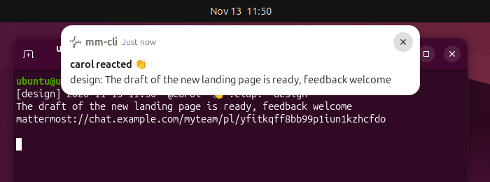
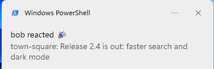
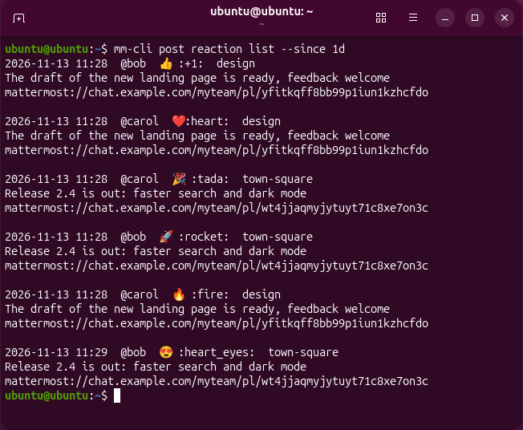

# mm-cli

Mattermost from the command line, for people and for scripts and AI agents. Read, send, edit and delete messages and files in any channel, react to messages, and get a desktop notification when someone reacts to your message; a click opens the message in the Mattermost desktop app. Every command can print JSON with stable field names, and `--help` is written to be sufficient for an agent. Sign-in goes through the same SSO flow as the desktop app.

[Русская версия](README.ru.md) · [Command reference](docs/cli.md) · [Decisions](docs/adr/README.md) · [Changelog](CHANGELOG.md)

## Contents

- [Screenshots](#screenshots)
- [Features](#features)
- [Install](#install)
- [Sign in](#sign-in)
- [Watching messages and reactions](#watching-messages-and-reactions)
- [Addressing channels](#addressing-channels)
- [Examples](#examples)
- [Output](#output)
- [Exit codes](#exit-codes)
- [Load on the server](#load-on-the-server)
- [Configuration](#configuration)
- [Development](#development)
- [License](#license)

## Screenshots



A reaction notification on GNOME; a click opens the message in the Mattermost desktop app.



The same notification as a Windows toast.



`mm-cli post reaction list` in a terminal.

On macOS notifications go through `terminal-notifier` (or `osascript`, which cannot open the message) and are expected to work the same way; there is no macOS screenshot.

## Features

- Desktop notifications about reactions to your messages, and optionally about new messages, with a click that opens the message in the Mattermost desktop app: Linux (D-Bus, any freedesktop notification server), macOS and Windows.
- `watch`: a stream of new messages and reactions over one WebSocket connection, with a catch-up of what was missed after a reconnect; text or one JSON object per line.
- Reactions: add (or replace one of yours), remove, list all reactions of a message, list the history of reactions on your messages (`post reaction add|remove|list`). Mattermost itself has no such history.
- Emoji are shown as characters (`👍 :+1:`); a custom emoji is attached to a notification as its picture.
- Built for AI agents: complete `--help` with JSON fields and exit codes for every command, `mm-cli help agents`, `--json` everywhere.
- The session token is kept in the OS secret store (macOS Keychain, Windows Credential Manager, Secret Service on Linux), not in a file.
- Sign-in through SSO (SAML, GitLab, OpenID Connect, Google, Office 365) with the desktop-app flow, so no personal access token is needed; two-factor authentication happens in the browser as usual. A token from stdin works too.
- Messages: send with attachments, list, read threads, search, edit, view and restore earlier versions, delete.
- Files: list a channel's attachments, download, replace or remove an attachment of your message.
- Channels: create, show, list (with unread counts), edit, archive, mark as read.
- Followed threads (the Threads view): list with unread counts, follow, unfollow, mark read.
- Scheduled messages (Drafts > Scheduled): schedule a message for tomorrow, Monday or any time, optionally every week; list, edit, reschedule, send now, delete (the server needs scheduled messages turned on and a license; otherwise the commands exit with code 5).
- Pinned and saved messages, channel bookmarks (bookmarks need a server that has them turned on; otherwise the commands exit with code 5).
- Your profile on the server (names, nickname, position, time zone, picture), status (online, away, do not disturb, offline) and custom status.
- Several servers side by side, each saved under a name (`auth list`, `auth set`).
- Text output for people, `--json` for scripts and agents.

## Install

With Go 1.26.11 or later:

```sh
go install github.com/VitalyOstanin/mm-cli/cmd/mm-cli@latest
```

Or download a binary for Linux or Windows (amd64) or macOS (Apple silicon or Intel) from the [releases page](https://github.com/VitalyOstanin/mm-cli/releases) and check it against `checksums.txt`.

The macOS binaries are not signed or notarized, so Gatekeeper blocks the first start of a downloaded file. After checking the checksum, remove the quarantine attribute:

```sh
xattr -d com.apple.quarantine mm-cli
```

## Sign in

```sh
mm-cli auth login https://chat.example.com
```

mm-cli opens the server's sign-in page in your browser. After you sign in (including any second factor), the browser lands on a page whose address starts with `https://chat.example.com/login/desktop?client_token=...`. Copy that address and paste it into the terminal within 3 minutes.

To skip the copying, register mm-cli once as the handler of the `mattermost-dev://` link that page offers (Linux, Windows and macOS):

```sh
mm-cli auth handler install
```

The browser then asks to open the link; allow it, and the waiting `auth login` finishes by itself, also when the browser was already signed in to Mattermost and moves on to a channel. `mm-cli auth handler remove` undoes the registration.

Without the handler:

- The page's offer to open a link leads nowhere: copy the address instead.
- If the browser was already signed in to Mattermost, it moves on to a channel at once. Take the address from the browser history (search for `login/desktop`), or sign in from a private window.

Without a terminal (scripts, agents) the login runs in two steps:

```sh
mm-cli auth login https://chat.example.com --no-browser
# open the printed address, sign in, copy the /login/desktop address, then
# pass it on stdin within 3 minutes:
mm-cli auth login --name chat-example-com --callback - < address.txt
```

The first step exits with code 0 without logging in. With `--json` it prints `{"status": "pending", "server": "...", "url": "...", "method": "saml", "login_url": "...", "expires_in": 180, "next": "mm-cli auth login --name ... --callback -"}`; a finished login prints `"status": "logged_in"` with the server name, user and team. `--callback '<address>'` also works, but the address carries a one-time token and is then visible to other local users in the process list and stays in the shell history.

With a personal access token or a session token instead:

```sh
mm-cli auth login https://chat.example.com --token-stdin < token.txt
```

`mm-cli auth check` shows who is signed in; `mm-cli auth logout` ends the session on the server and deletes the local token.

When you belong to several teams, pass `--team myteam` to `auth login` to make it the default, or `--team` to any command.

## Watching messages and reactions

`mm-cli watch` keeps one WebSocket connection open and prints events until interrupted; it does not poll. Without arguments it watches every channel you are a member of; channel arguments (see [Addressing channels](#addressing-channels)) narrow it down.

| Command                                 | What it prints                                            |
|-----------------------------------------|-----------------------------------------------------------|
| `mm-cli watch`, `watch --messages`      | new messages                                              |
| `mm-cli watch --reactions`              | reactions other people put on your messages               |
| `mm-cli watch --messages --reactions`   | both in one stream                                        |

With `--json` each event is one JSON object per line. The `type` field is `post` (a message, with the extra fields `channel`, `channel_display_name` and `team`) or `reaction`. In both, `channel` is the channel address as mm-cli accepts it: the channel name for a public or private channel, `@<username>` for a direct channel (the channel id if the user cannot be looked up), the channel id for a group message. `channel_display_name` is the name the app shows (`Town Square`, `@bob`); `team` is the team name, empty for direct and group channels. Reply with `mm-cli send <team>:<channel>` or by `channel_id`:

```json
{"type": "reaction", "post_id": "...", "root_id": "", "channel_id": "...", "channel": "town-square", "team": "myteam", "user_id": "...", "user": "bob", "emoji": "+1", "create_at": "2026-11-12T09:41:07Z", "message": "release notes are ready", "permalink": "https://chat.example.com/myteam/pl/...", "app_link": "mattermost://chat.example.com/myteam/pl/..."}
```

- Your own reactions and messages are skipped; `--include-own` shows and announces them too, which helps to check notifications: post to `@me`, react, click the notification.
- The event does not say who wrote the message, so the first reaction on a message costs one `GET /posts/<id>` request; later reactions on it cost nothing.
- After a reconnect (pause of 1, 2, 4 ... up to 60 seconds) the events sent in the meantime are fetched and printed in time order, without duplicates, and stderr gets `mm-cli: reconnected; caught up 2 messages and 1 reactions since 09:41:07`. The first connection has no catch-up. A reaction made while offline on a message older than 7 days is not caught up. Reactions missed while offline are searched for at most once per 10 minutes: after a sooner reconnect the search is postponed (nothing is lost, the later one covers the whole gap), so such a reaction can appear up to 10 minutes late; messages are caught up on every reconnect, and live reactions are not delayed.
- Watching does not mark channels as read.
- Exit code 3 means no session or an expired one: sign in again.

### Reactions

```sh
mm-cli post reaction add <post-id> +1
mm-cli post reaction add <post-id> heart --replace +1   # swap one of your reactions
mm-cli post reaction remove <post-id> +1
mm-cli post reaction list <post-id>                      # all reactions of one message
mm-cli post reaction list --since 7d                     # history on your messages
```

```
2026-11-12 09:41  @bob  👍 :+1:  town-square
release notes are ready
mattermost://chat.example.com/myteam/pl/...
```

`post reaction list` without an id shows the reactions other people put on your messages posted since `--since` (a duration such as `90m`, `2h`, `3d`, or an RFC 3339 time; default 7 days), newest 20 by default (`-n`, at most 200). The `reactions` field of message and thread output shows them too.

### Desktop notifications

`--notify` shows a desktop notification for every watched event, besides the output. The title is `bob reacted 👍` or `bob in town-square`, the body is the start of the message. `--urgency low|normal|critical` sets the freedesktop urgency (on GNOME, `critical` keeps the banner until it is closed and breaks through Do Not Disturb); it needs `--notify` and has no effect on macOS and Windows.

```sh
mm-cli watch --reactions --notify
mm-cli watch --messages --reactions --notify --urgency critical
```

- Linux and other unix: a notification server on the session bus (GNOME, KDE, dunst, mako ...), nothing else. A click runs `xdg-open` on the `mattermost://` link, for as long as `watch` runs.
- macOS: `brew install terminal-notifier` makes a click open the message. Without it `osascript` is used: nothing opens, and a hint goes to stderr.
- Windows: nothing extra (a toast through `powershell.exe`). A click opens the message.

A missing notification service ends the command with exit code 1. More than 3 notifications of one catch-up become a single `mm-cli: N missed messages, M missed reactions`. When the session is gone, one notification `mm-cli: sign in again` appears and the command exits with code 3.

### Using from AI agents

Run `watch` as a background process and stop it when the session ends; on exit code 3 stop instead of restarting it in a loop. There are two ways:

- The agent only starts the notifications: `mm-cli watch --reactions --notify` (add `--messages` for messages). The desktop shows them; the agent does not follow the output.
- The agent reads the stream and tells the user itself: `mm-cli watch --json --messages --reactions` without `--notify`. For the context of a reaction it loads the thread with `mm-cli post thread <root_id> --json` (or `<post_id>` when `root_id` is empty; any id of the thread works).

An agent that cannot react to a background process line by line polls instead, every few minutes and not every few seconds, remembering the newest `create_at` it has seen:

```sh
mm-cli post reaction list --since 15m --json
mm-cli post list town-square --since 15m --json
```

`mm-cli help agents` has the same guidance.

### Running as a service

Linux: a systemd user unit, installed and started with:

```sh
mkdir -p ~/.config/systemd/user
cp docs/examples/mm-cli-watch.service ~/.config/systemd/user/   # then set ExecStart= to `command -v mm-cli`
systemctl --user daemon-reload && systemctl --user enable --now mm-cli-watch.service
```

Details, checks, an expired session, containers and other ways: [docs/watch-in-background.md](docs/watch-in-background.md). On macOS use a launchd agent, on Windows a Task Scheduler task at logon; both run `mm-cli watch --reactions --notify`.

## Addressing channels

| Address              | Meaning                                                        |
|----------------------|----------------------------------------------------------------|
| `@me`                | your direct channel with yourself, a place for notes and files |
| `@bob`               | the direct channel with bob, created on first use              |
| `town-square`        | a channel in the default team                                  |
| `myteam:town-square` | a channel in another team                                      |
| 26-character id      | a channel id                                                   |

Resolved ids are cached per server, so a name costs one request only the first time.

## Examples

```sh
mm-cli send @me "note to self"
mm-cli send @me -f report.pdf -f photo.jpg
echo "multi-line text" | mm-cli send town-square -
mm-cli send town-square "a reply" --reply-to <post-id>
mm-cli send town-square "standup in 5 minutes" --schedule "2026-11-12 09:55"
mm-cli scheduled list

mm-cli messages town-square -n 50 --since 3d
mm-cli post thread <post-id>
mm-cli thread list --unread
mm-cli thread mark-read <post-id>
mm-cli post search deploy --in town-square --from @bob
mm-cli post edit <post-id> "corrected text"
mm-cli post delete <post-id> --confirm
mm-cli post pin <post-id>
mm-cli post save <post-id>
mm-cli post saved -n 50

mm-cli file list town-square
mm-cli file search report --ext pdf
mm-cli file download <post-id> -o ~/Downloads
mm-cli file download <file-id> --file -o ~/Downloads

mm-cli status set dnd --until 1h
mm-cli status custom set "In a meeting" --emoji calendar --clear-after 1h
mm-cli profile edit --position "Release manager"

mm-cli channel create notes --private --exist-ok
mm-cli channel list --unread
mm-cli watch town-square @bob
mm-cli watch --reactions --notify
mm-cli post reaction add <post-id> +1
mm-cli post reaction list --since 7d
```

Every command is described in [docs/cli.md](docs/cli.md) and in `mm-cli <command> --help`. For AI agents and scripts, `mm-cli help agents` and the other help topics (`addressing`, `output`, `exit-codes`, `login`, `config`, `load`) describe everything needed without this README.

Reading a channel (`messages`, `post thread`, `watch`) does not mark it as read; `mm-cli channel mark-read` does. Likewise `thread list` and `post thread` leave threads unread; `mm-cli thread mark-read` marks them read. Following a thread marks it read on the server.

## Output

Text output shows one entry per message: local time, `@author`, message id, thread details, the text and attachment lines. With `--json` commands print JSON with stable field names:

```json
{
  "id": "...",
  "channel_id": "...",
  "root_id": "",
  "create_at": "2026-01-02T15:04:05Z",
  "user": {"id": "...", "username": "alice"},
  "message": "hello",
  "files": [{"id": "...", "name": "report.pdf", "size": 12345, "mime": "application/pdf"}],
  "reply_count": 0,
  "edited": false,
  "pinned": false
}
```

`watch --json` prints one such object per line, with the extra fields `type` (`post`), `channel`, `channel_display_name` and `team` (see the field meanings in [Watching messages and reactions](#watching-messages-and-reactions)); reactions are printed as objects with `"type": "reaction"` (see [Watching messages and reactions](#watching-messages-and-reactions)).

Commands that change something without returning the changed object print what they did:

| Command                                     | `--json` output                                                                      |
|---------------------------------------------|--------------------------------------------------------------------------------------|
| `post pin`, `post unpin`                    | `{"action": "pinned"}` or `"unpinned"`, `"id"`: the message id                       |
| `post save`, `post unsave`                  | `{"action": "saved"}` or `"unsaved"`, `"id"`: the message id                         |
| `channel archive`, `unarchive`, `mark-read` | `{"action": "archived"}`, `"unarchived"` or `"marked_read"`, `"id"`: the channel id  |
| `thread follow`, `unfollow`, `mark-read`    | `[{"action": "followed"}, ...]`, `"unfollowed"` or `"marked_read"`, `"id"`: root id  |
| `thread mark-read --all`                    | `[{"action": "marked_read", "team": "<team name>"}, ...]`                            |
| `bookmark delete`                           | `{"action": "deleted", "id": "<bookmark>", "channel_id": "..."}`                     |
| `post delete`                               | `[{"action": "deleted", "id": "<message>"}, ...]`                                    |
| `scheduled delete`                          | `[{"action": "deleted", "id": "<scheduled message>"}, ...]`                          |
| `file replace`                              | `{"action": "replaced", "post_id": "...", "old_file_id": "...", "file_id": "<new>"}` |
| `file remove`                               | `{"action": "removed", "post_id": "...", "file_id": "..."}`                          |
| `file download`                             | `[{"file_id": "...", "path": "./report.pdf", "size": 12345}, ...]`                   |
| `auth logout`                               | `{"action": "logged_out", "server": "<name>"}`                                       |
| `auth set <name>`                           | `{"action": "current_set", "server": "<name>"}`                                      |
| `auth delete`                               | `{"action": "deleted", "server": "<name>"}`                                          |
| `profile picture set`, `reset`              | `{"action": "picture_set"}` or `"picture_reset"`                                     |
| `status custom clear`                       | `{"action": "custom_status_cleared"}`                                                |

When `post delete`, `file download` or a `thread` command fails part-way, stdout still lists what was done before the error.

Errors with `--json` go to stderr as `{"error": {"code": 5, "message": "..."}}`. The JSON format is a public interface: changes are recorded in the [changelog](CHANGELOG.md).

## Exit codes

| Code | Meaning                                    |
|------|--------------------------------------------|
| 0    | success                                    |
| 1    | other error                                |
| 2    | wrong usage: arguments, flags, local files |
| 3    | not signed in, or the session has expired  |
| 4    | forbidden                                  |
| 5    | not found                                  |
| 6    | rate limited by the server after retries   |
| 7    | network error                              |
| 130  | stopped by SIGINT (Ctrl+C)                 |
| 143  | stopped by SIGTERM                         |

## Load on the server

mm-cli is meant to be gentle with shared servers:

- At most 1 request per second with bursts of 3, per process; a saved server may change this.
- On `429 Too Many Requests` it waits as the server asks (`Retry-After`, 5 seconds by default), up to 3 times, and halves its own rate; the rate grows back slowly after successful requests and with time.
- A wait the server asks for is never shortened. If it is longer than 2 minutes, the command fails at once with exit code 6 and says until when the server refuses requests.
- The ban and the reduced rate are kept for the server in `ratelimit.json` in the cache directory, so the next commands honour them too: a new command waits for a short ban (printing `mm-cli: rate limited by the server, waiting Ns` to stderr) or fails with code 6 during a long one.
- Network errors and `502`/`503`/`504` are retried only for reads; sending and deleting are never repeated.
- No polling: `watch` keeps one WebSocket connection and reconnects with a pause of 1, 2, 4 ... up to 60 seconds.
- Author names are fetched in one request per page of messages.

## Configuration

Files live in the user configuration directory (`~/.config/mm-cli` on Linux), or in `$MM_CONFIG_DIR`:

| Path                    | Contents                                                   |
|-------------------------|------------------------------------------------------------|
| `config.yaml`           | saved servers: URL, default team, rate limit, User-Agent   |
| `sessions/<name>.token` | the session token, only with `token_storage: file` (0600)  |

By default the session token is kept in the OS secret store (macOS Keychain, Windows Credential Manager, Secret Service on Linux and BSD: GNOME Keyring, KWallet, KeePassXC), not in a file. Without a usable store mm-cli fails with exit code 1 and never falls back to a file by itself; to keep tokens in files, put `token_storage: file` into `config.yaml` or set `MM_TOKEN_STORAGE=file` (containers, CI, headless hosts). The entry is named after the saved server and its address (account `chat https://chat.example.com`, service `mm-cli`), so servers with the same name and different addresses never share a token. A token file of an earlier version is moved into the store on first use.

The secret store keeps the token away from backups and from other users, but not from other processes of the same user: any program running as you can ask the store for it (usually after the store is unlocked at login), and a token file is readable by them as well. Treat every program you run as able to use your Mattermost session.

The address cache is kept in the user cache directory (`~/.cache/mm-cli` on Linux), or in `$MM_CONFIG_DIR/cache`. User names in it are checked with the server again after 7 days, so a renamed user shows up under the new name.

```yaml
current: chat-example-com
token_storage: keyring   # optional; keyring (default) or file
servers:
  chat-example-com:
    url: https://chat.example.com
    team: myteam
    rate_limit:        # optional; per_second at most 10, burst at most 20
      per_second: 1
      burst: 3
    user_agent: "Mozilla/5.0 example"   # optional; default mm-cli/<version>
```

`mm-cli auth login --name <name>` saves a server under a name (by default the host with dots replaced by `-`). `--server <name>` or `$MM_SERVER` selects a saved server, else the current one is used; `mm-cli auth list` shows them, `mm-cli auth set <name>` makes one current, `mm-cli auth delete <name>` removes one. A `config.yaml` of mm-cli 0.1 kept the servers under `profiles` and the current one under `default`: rename the two keys, or delete the file and log in again.

## Development

```sh
scripts/check.sh          # what CI runs: gofmt, go vet, golangci-lint, tests with -race, govulncheck
scripts/check.sh --fix    # apply formatting and lint fixes, then run the quick checks
scripts/integration.sh    # tests against a real Mattermost in a container
scripts/gen-cli-doc.sh    # regenerate docs/cli.md after changing commands or help text
```

CI regenerates [docs/cli.md](docs/cli.md) and fails if it differs from the committed file, so commit the regenerated reference together with the change. Shell scripts are checked with `shellcheck`, GitHub workflows with `actionlint` and [zizmor](https://docs.zizmor.sh/); `scripts/check.sh` runs zizmor through `uvx` when [uv](https://docs.astral.sh/uv/) is installed.

### Layout

| Package            | Purpose                                                                        |
|--------------------|--------------------------------------------------------------------------------|
| `cmd/mm-cli`       | `main`                                                                         |
| `internal/cli`     | cobra commands, one file per resource                                          |
| `internal/client`  | `model.Client4` with the rate-limiting, 429-aware transport                    |
| `internal/auth`    | desktop-app SSO flow                                                           |
| `internal/config`  | saved servers, session tokens (OS secret store, file fallback), pending logins |
| `internal/resolve` | channel addresses (`@me`, `@user`, `team:name`, id) and cache                  |
| `internal/render`  | text and JSON output; JSON field names are a public interface                  |
| `internal/clierr`  | exit codes                                                                     |
| `internal/fakemm`  | fake Mattermost server for tests                                               |

Design decisions are recorded in [docs/adr](docs/adr/README.md).

### Releasing

1. Rename `## [Unreleased]` in [CHANGELOG.md](CHANGELOG.md) to `## [X.Y.Z] - YYYY-MM-DD`, add a new empty `## [Unreleased]`, update the compare links at the end of the file (`[Unreleased]: .../compare/vX.Y.Z...HEAD`, `[X.Y.Z]: .../compare/vPREV...vX.Y.Z`) and commit.
2. Tag the commit with an annotated tag `vX.Y.Z` and push the tag: `git tag -a vX.Y.Z -m "mm-cli X.Y.Z" && git push origin vX.Y.Z`.
3. The release workflow checks at once that the CHANGELOG section exists, runs the whole CI workflow (lint, tests on Linux, macOS and Windows, integration tests, vulnerability scan, build check) and publishes nothing unless every job passes; then it builds the binaries, attaches `checksums.txt` and `THIRD_PARTY_NOTICES`, and takes the release text from that CHANGELOG section; it fails if the section is missing or empty.

Integration tests start `mattermost/mattermost-preview` in podman (or docker), create users, a team and content on it, and remove the container afterwards. They never talk to any other server.

The repository is public: code, tests and documentation use only made-up data such as `chat.example.com`, `alice`, `bob`, `myteam` and `town-square`. The pre-commit hook checks staged changes against a private list of forbidden strings kept outside the repository (`~/.config/mm-cli-dev/denylist`); enable the hooks with `git config core.hooksPath .githooks`.

## License

[MIT](LICENSE), copyright (c) 2026 Vitaly Ostanin.
