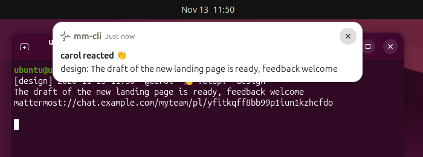
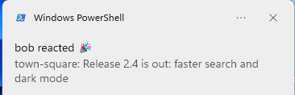
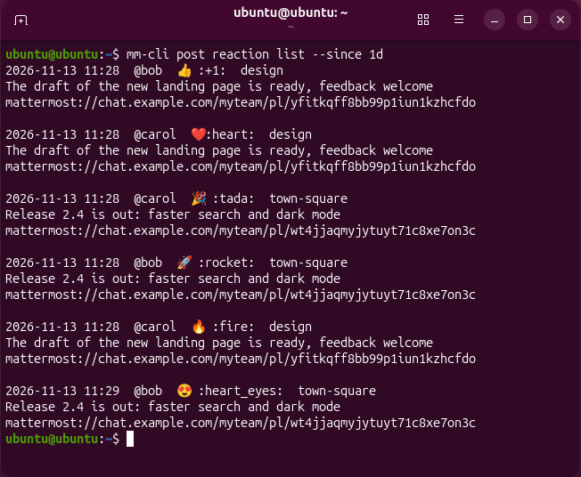

# mm-cli

Mattermost из командной строки, для людей и для скриптов и AI-агентов. Чтение, отправка, правка и удаление сообщений и файлов в любом канале, реакции на сообщения и уведомление на рабочем столе, когда кто-то поставил реакцию на ваше сообщение; щелчок по уведомлению открывает сообщение в приложении Mattermost. Каждая команда умеет печатать JSON с устойчивыми именами полей, а `--help` написан так, чтобы агенту хватало его одного. Вход идёт через тот же поток SSO, что у приложения для рабочего стола.

[English version](README.md) · [Справочник команд](docs/cli.md) (на английском) · [Решения](docs/adr/README.md) · [Изменения](CHANGELOG.md)

## Содержание

- [Снимки экрана](#снимки-экрана)
- [Возможности](#возможности)
- [Установка](#установка)
- [Вход](#вход)
- [Наблюдение за сообщениями и реакциями](#наблюдение-за-сообщениями-и-реакциями)
- [Адреса каналов](#адреса-каналов)
- [Примеры](#примеры)
- [Вывод](#вывод)
- [Коды возврата](#коды-возврата)
- [Нагрузка на сервер](#нагрузка-на-сервер)
- [Настройки](#настройки)
- [Разработка](#разработка)
- [Лицензия](#лицензия)

## Снимки экрана



Уведомление о реакции в GNOME; щелчок открывает сообщение в приложении Mattermost.



То же уведомление в виде toast в Windows.



`mm-cli post reaction list` в терминале.

В macOS уведомления идут через `terminal-notifier` (или через `osascript`, который не умеет открывать сообщение) и, как ожидается, работают так же; снимка для macOS нет.

## Возможности

- Уведомления на рабочем столе о реакциях на ваши сообщения и, при желании, о новых сообщениях; щелчок открывает сообщение в приложении Mattermost. Linux (D-Bus, любой сервер уведомлений freedesktop), macOS и Windows.
- `watch`: поток новых сообщений и реакций через одно WebSocket-соединение; после переподключения подтягивается всё пропущенное; вывод текстом или по одному JSON-объекту на строку.
- Реакции: поставить (или заменить свою), снять, список всех реакций сообщения, история реакций на ваши сообщения (`post reaction add|remove|list`). Такой истории в самом Mattermost нет.
- Эмодзи показываются символами (`👍 :+1:`); картинка своего эмодзи прикладывается к уведомлению.
- Сделан для AI-агентов: полная справка `--help` с полями JSON и кодами возврата у каждой команды, `mm-cli help agents`, `--json` везде.
- Токен сессии хранится в защищённом хранилище ОС (Keychain в macOS, Credential Manager в Windows, Secret Service в Linux), а не в файле.
- Вход через SSO (SAML, GitLab, OpenID Connect, Google, Office 365) по потоку приложения для рабочего стола, без персонального токена; двухфакторная проверка проходит в браузере как обычно. Можно войти и с токеном из stdin.
- Сообщения: отправка с вложениями, список, треды, поиск, правка, просмотр и восстановление прежних версий, удаление.
- Файлы: вложения канала, скачивание, замена или удаление вложения своего сообщения.
- Каналы: создание, просмотр, список (с числом непрочитанных), изменение, архивация, отметка о прочтении.
- Отслеживаемые обсуждения (раздел «Обсуждения»): список с числом непрочитанных, подписка, отписка, отметка о прочтении.
- Запланированные сообщения (Черновики → Запланированные): отправка завтра, в понедельник или в любое время, при желании каждую неделю; список, правка текста, перенос, отправка сразу, удаление (на сервере должны быть включены запланированные сообщения и установлена лицензия; иначе команды завершаются с кодом 5).
- Закреплённые и сохранённые сообщения, закладки канала (закладки работают, только если они включены на сервере; иначе команды завершаются с кодом 5).
- Профиль пользователя на сервере (имя, псевдоним, должность, часовой пояс, аватар), статус (в сети, отошёл, не беспокоить, не в сети) и пользовательский статус.
- Несколько серверов одновременно, каждый сохранён под своим именем (`auth list`, `auth set`).
- Вывод текстом для людей, `--json` для скриптов и агентов.

## Установка

С Go 1.26.11 или новее:

```sh
go install github.com/VitalyOstanin/mm-cli/cmd/mm-cli@latest
```

Или скачайте бинарник для Linux или Windows (amd64) либо для macOS (Apple silicon или Intel) со [страницы выпусков](https://github.com/VitalyOstanin/mm-cli/releases) и сверьте его с `checksums.txt`.

Бинарники для macOS не подписаны и не прошли нотаризацию, поэтому Gatekeeper блокирует первый запуск скачанного файла. После сверки контрольной суммы снимите атрибут карантина:

```sh
xattr -d com.apple.quarantine mm-cli
```

## Вход

```sh
mm-cli auth login https://chat.example.com
```

mm-cli открывает в браузере страницу входа сервера. После входа (включая второй фактор) браузер попадает на страницу с адресом вида `https://chat.example.com/login/desktop?client_token=...`. Скопируйте этот адрес и вставьте в терминал в течение 3 минут.

Чтобы не копировать адрес, один раз зарегистрируйте mm-cli обработчиком ссылки `mattermost-dev://`, которую предлагает открыть эта страница (Linux, Windows и macOS):

```sh
mm-cli auth handler install
```

Тогда браузер спросит, открыть ли ссылку; разрешите, и ожидающий `auth login` завершится сам, в том числе когда в браузере уже выполнен вход в Mattermost и страница сразу уходит в канал. `mm-cli auth handler remove` отменяет регистрацию.

Без обработчика:

- Предложение страницы открыть ссылку ни к чему не приведёт: скопируйте адрес.
- Если в браузере уже выполнен вход в Mattermost, он сразу уходит в канал. Возьмите адрес из истории браузера (поиск по `login/desktop`) или войдите из приватного окна.

Без терминала (скрипты, агенты) вход идёт в два шага:

```sh
mm-cli auth login https://chat.example.com --no-browser
# откройте напечатанный адрес, войдите, скопируйте адрес /login/desktop и
# в течение 3 минут передайте его через stdin:
mm-cli auth login --name chat-example-com --callback - < address.txt
```

Первый шаг завершается с кодом 0, но вход ещё не выполнен. С `--json` он печатает `{"status": "pending", "server": "...", "url": "...", "method": "saml", "login_url": "...", "expires_in": 180, "next": "mm-cli auth login --name ... --callback -"}`; завершённый вход печатает `"status": "logged_in"` с именем сервера, пользователем и командой. Вариант `--callback '<адрес>'` тоже работает, но адрес содержит одноразовый токен: он виден другим локальным пользователям в списке процессов и остаётся в истории оболочки.

С персональным токеном или токеном сессии:

```sh
mm-cli auth login https://chat.example.com --token-stdin < token.txt
```

`mm-cli auth check` показывает, кто вошёл; `mm-cli auth logout` завершает сессию на сервере и удаляет локальный токен.

Если вы состоите в нескольких командах, передайте `--team myteam` в `auth login`, чтобы сделать её командой по умолчанию, или `--team` в любую команду.

## Наблюдение за сообщениями и реакциями

`mm-cli watch` держит одно WebSocket-соединение и печатает события, пока его не прервут; опроса нет. Без аргументов команда следит за всеми каналами, в которых вы состоите; аргументы-каналы (см. [Адреса каналов](#адреса-каналов)) сужают набор.

| Команда                                 | Что печатает                                              |
|-----------------------------------------|-----------------------------------------------------------|
| `mm-cli watch`, `watch --messages`      | новые сообщения                                           |
| `mm-cli watch --reactions`              | реакции других людей на ваши сообщения                    |
| `mm-cli watch --messages --reactions`   | и то и другое в одном потоке                              |

С `--json` каждое событие — один JSON-объект на строку. Поле `type` равно `post` (сообщение, с дополнительными полями `channel`, `channel_display_name` и `team`) или `reaction`. В обоих `channel` — адрес канала в том виде, который принимает mm-cli: имя канала для публичного или приватного канала, `@<username>` для личного (id канала, если пользователя не удалось найти), id канала для группового сообщения. `channel_display_name` — название, которое показывает приложение (`Town Square`, `@bob`); `team` — имя команды, для личных и групповых каналов пусто. Ответить можно командой `mm-cli send <team>:<channel>` или по `channel_id`:

```json
{"type": "reaction", "post_id": "...", "root_id": "", "channel_id": "...", "channel": "town-square", "team": "myteam", "user_id": "...", "user": "bob", "emoji": "+1", "create_at": "2026-11-12T09:41:07Z", "message": "release notes are ready", "permalink": "https://chat.example.com/myteam/pl/...", "app_link": "mattermost://chat.example.com/myteam/pl/..."}
```

- Ваши собственные реакции и сообщения пропускаются; `--include-own` показывает и объявляет их тоже, что удобно для проверки уведомлений: напишите в `@me`, поставьте реакцию, щёлкните по уведомлению.
- Событие не сообщает, кто автор сообщения, поэтому первая реакция на сообщение стоит одного запроса `GET /posts/<id>`; следующие реакции на него ничего не стоят.
- После переподключения (пауза 1, 2, 4 … до 60 секунд) события, пришедшие за это время, подтягиваются и печатаются по порядку времени, без повторов, а в stderr выводится `mm-cli: reconnected; caught up 2 messages and 1 reactions since 09:41:07`. После первого соединения подтягивания нет. Реакция, поставленная в отсутствие связи на сообщение старше 7 дней, не подтягивается. Реакции, пропущенные в отсутствие связи, ищутся не чаще одного раза в 10 минут: после более раннего переподключения поиск откладывается (ничего не теряется, поздний охватит весь пропуск), поэтому такая реакция может появиться с опозданием до 10 минут; сообщения подтягиваются при каждом переподключении, реакции в реальном времени не задерживаются.
- Наблюдение не отмечает каналы прочитанными.
- Код возврата 3 означает, что сессии нет или она истекла: войдите заново.

### Реакции

```sh
mm-cli post reaction add <post-id> +1
mm-cli post reaction add <post-id> heart --replace +1   # заменить свою реакцию
mm-cli post reaction remove <post-id> +1
mm-cli post reaction list <post-id>                      # все реакции одного сообщения
mm-cli post reaction list --since 7d                     # история на ваши сообщения
```

```
2026-11-12 09:41  @bob  👍 :+1:  town-square
release notes are ready
mattermost://chat.example.com/myteam/pl/...
```

`post reaction list` без id показывает реакции других людей на ваши сообщения, написанные за период `--since` (длительность вроде `90m`, `2h`, `3d` или время в RFC 3339; по умолчанию 7 дней), по умолчанию последние 20 (`-n`, не больше 200). Реакции видны и в поле `reactions` вывода сообщений и тредов.

### Уведомления на рабочем столе

`--notify` показывает уведомление на рабочем столе о каждом наблюдаемом событии, помимо обычного вывода. Заголовок — `bob reacted 👍` или `bob in town-square`, текст — начало сообщения. `--urgency low|normal|critical` задаёт срочность freedesktop (в GNOME `critical` держит баннер на экране до закрытия и показывает его даже в режиме «Не беспокоить»); нужен `--notify`, в macOS и Windows не действует.

```sh
mm-cli watch --reactions --notify
mm-cli watch --messages --reactions --notify --urgency critical
```

- Linux и прочие unix: сервер уведомлений на сессионной шине (GNOME, KDE, dunst, mako …), больше ничего. Щелчок запускает `xdg-open` со ссылкой `mattermost://`, пока работает `watch`.
- macOS: `brew install terminal-notifier` даёт открытие сообщения по щелчку. Без него используется `osascript`: ничего не открывается, а в stderr выводится подсказка.
- Windows: ничего дополнительного (toast через `powershell.exe`). Щелчок открывает сообщение.

Если сервера уведомлений нет, команда завершается с кодом 1. Больше 3 уведомлений одного подтягивания сливаются в одно: `mm-cli: N missed messages, M missed reactions`. Когда сессия пропала, появляется одно уведомление `mm-cli: sign in again`, и команда завершается с кодом 3.

### Работа из AI-агентов

Запускайте `watch` фоновым процессом и останавливайте, когда сессия завершается; при коде возврата 3 остановитесь, а не перезапускайте его в цикле. Есть два способа:

- Агент только запускает уведомления: `mm-cli watch --reactions --notify` (с `--messages` — и для сообщений). Их показывает рабочий стол; следить за выводом агенту не нужно.
- Агент читает поток и сообщает пользователю сам: `mm-cli watch --json --messages --reactions` без `--notify`. Для контекста реакции он загружает тред командой `mm-cli post thread <root_id> --json` (или `<post_id>`, когда `root_id` пуст; подходит любой id треда).

Агент, который не может реагировать на фоновый процесс построчно, опрашивает сам — раз в несколько минут, а не секунд, запоминая самый новый увиденный `create_at`:

```sh
mm-cli post reaction list --since 15m --json
mm-cli post list town-square --since 15m --json
```

То же сказано в `mm-cli help agents`.

### Запуск как службы

Linux: пользовательский unit systemd, установка и запуск:

```sh
mkdir -p ~/.config/systemd/user
cp docs/examples/mm-cli-watch.service ~/.config/systemd/user/   # затем впишите в ExecStart= вывод `command -v mm-cli`
systemctl --user daemon-reload && systemctl --user enable --now mm-cli-watch.service
```

Подробности, проверка, истёкшая сессия, контейнеры и другие способы: [docs/watch-in-background.ru.md](docs/watch-in-background.ru.md). В macOS используйте агент launchd, в Windows — задачу планировщика при входе; обе запускают `mm-cli watch --reactions --notify`.

## Адреса каналов

| Адрес                | Значение                                                |
|----------------------|---------------------------------------------------------|
| `@me`                | личный канал с самим собой — место для заметок и файлов |
| `@bob`               | личный канал с bob, создаётся при первом обращении      |
| `town-square`        | канал в команде по умолчанию                            |
| `myteam:town-square` | канал в другой команде                                  |
| id из 26 символов    | id канала                                               |

Найденные id кешируются для каждого сервера, поэтому имя стоит запроса только в первый раз.

## Примеры

```sh
mm-cli send @me "заметка себе"
mm-cli send @me -f report.pdf -f photo.jpg
echo "многострочный текст" | mm-cli send town-square -
mm-cli send town-square "ответ" --reply-to <post-id>
mm-cli send town-square "планёрка через 5 минут" --schedule "2026-11-12 09:55"
mm-cli scheduled list

mm-cli messages town-square -n 50 --since 3d
mm-cli post thread <post-id>
mm-cli thread list --unread
mm-cli thread mark-read <post-id>
mm-cli post search deploy --in town-square --from @bob
mm-cli post edit <post-id> "исправленный текст"
mm-cli post delete <post-id> --confirm
mm-cli post pin <post-id>
mm-cli post save <post-id>
mm-cli post saved -n 50

mm-cli file list town-square
mm-cli file search report --ext pdf
mm-cli file download <post-id> -o ~/Downloads
mm-cli file download <file-id> --file -o ~/Downloads

mm-cli status set dnd --until 1h
mm-cli status custom set "На встрече" --emoji calendar --clear-after 1h
mm-cli profile edit --position "Release manager"

mm-cli channel create notes --private --exist-ok
mm-cli channel list --unread
mm-cli watch town-square @bob
mm-cli watch --reactions --notify
mm-cli post reaction add <post-id> +1
mm-cli post reaction list --since 7d
```

Все команды описаны в [docs/cli.md](docs/cli.md) и в `mm-cli <команда> --help`. Для AI-агентов и скриптов `mm-cli help agents` и остальные темы справки (`addressing`, `output`, `exit-codes`, `login`, `config`, `load`) описывают всё необходимое без этого README.

Чтение канала (`messages`, `post thread`, `watch`) не отмечает его прочитанным; отмечает `mm-cli channel mark-read`. Так же `thread list` и `post thread` не отмечают обсуждения прочитанными; отмечает `mm-cli thread mark-read`. Подписку на обсуждение сервер засчитывает как прочтение.

## Вывод

Текстовый вывод — одна запись на сообщение: местное время, `@автор`, id сообщения, сведения о треде, текст и строки вложений. С `--json` команды печатают JSON с устойчивыми именами полей:

```json
{
  "id": "...",
  "channel_id": "...",
  "root_id": "",
  "create_at": "2026-01-02T15:04:05Z",
  "user": {"id": "...", "username": "alice"},
  "message": "hello",
  "files": [{"id": "...", "name": "report.pdf", "size": 12345, "mime": "application/pdf"}],
  "reply_count": 0,
  "edited": false,
  "pinned": false
}
```

`watch --json` печатает по такому объекту на строку, с дополнительными полями `type` (`post`), `channel`, `channel_display_name` и `team` (значения полей — в разделе [Наблюдение за сообщениями и реакциями](#наблюдение-за-сообщениями-и-реакциями)); реакции печатаются объектами с `"type": "reaction"` (см. [Наблюдение за сообщениями и реакциями](#наблюдение-за-сообщениями-и-реакциями)).

Команды, которые что-то меняют, но не возвращают изменённый объект, печатают, что сделано:

| Команда                                     | Вывод с `--json`                                                                       |
|---------------------------------------------|----------------------------------------------------------------------------------------|
| `post pin`, `post unpin`                    | `{"action": "pinned"}` или `"unpinned"`, `"id"`: id сообщения                          |
| `post save`, `post unsave`                  | `{"action": "saved"}` или `"unsaved"`, `"id"`: id сообщения                            |
| `channel archive`, `unarchive`, `mark-read` | `{"action": "archived"}`, `"unarchived"` или `"marked_read"`, `"id"`: id канала        |
| `thread follow`, `unfollow`, `mark-read`    | `[{"action": "followed"}, ...]`, `"unfollowed"` или `"marked_read"`, `"id"`: id корня  |
| `thread mark-read --all`                    | `[{"action": "marked_read", "team": "<имя команды>"}, ...]`                            |
| `bookmark delete`                           | `{"action": "deleted", "id": "<закладка>", "channel_id": "..."}`                       |
| `post delete`                               | `[{"action": "deleted", "id": "<сообщение>"}, ...]`                                    |
| `scheduled delete`                          | `[{"action": "deleted", "id": "<запланированное>"}, ...]`                              |
| `file replace`                              | `{"action": "replaced", "post_id": "...", "old_file_id": "...", "file_id": "<новый>"}` |
| `file remove`                               | `{"action": "removed", "post_id": "...", "file_id": "..."}`                            |
| `file download`                             | `[{"file_id": "...", "path": "./report.pdf", "size": 12345}, ...]`                     |
| `auth logout`                               | `{"action": "logged_out", "server": "<name>"}`                                         |
| `auth set <name>`                           | `{"action": "current_set", "server": "<name>"}`                                        |
| `auth delete`                               | `{"action": "deleted", "server": "<name>"}`                                            |
| `profile picture set`, `reset`              | `{"action": "picture_set"}` или `"picture_reset"`                                      |
| `status custom clear`                       | `{"action": "custom_status_cleared"}`                                                  |

Если `post delete`, `file download` или команда `thread` прерывается ошибкой, в stdout всё равно выводится то, что успело выполниться.

Ошибки с `--json` уходят в stderr в виде `{"error": {"code": 5, "message": "..."}}`. Формат JSON — публичный интерфейс: изменения записываются в [CHANGELOG](CHANGELOG.md).

## Коды возврата

| Код | Значение                                             |
|-----|------------------------------------------------------|
| 0   | успех                                                |
| 1   | прочая ошибка                                        |
| 2   | неверное использование: аргументы, флаги, файлы      |
| 3   | вход не выполнен или сессия истекла                  |
| 4   | доступ запрещён                                      |
| 5   | не найдено                                           |
| 6   | сервер ограничил частоту запросов, повторы исчерпаны |
| 7   | сетевая ошибка                                       |
| 130 | остановлено сигналом SIGINT (Ctrl+C)                 |
| 143 | остановлено сигналом SIGTERM                         |

## Нагрузка на сервер

mm-cli бережёт общие серверы:

- Не больше 1 запроса в секунду с пачкой до 3 на процесс; сохранённый сервер может это изменить.
- На `429 Too Many Requests` ждёт столько, сколько просит сервер (`Retry-After`, по умолчанию 5 секунд), не более 3 раз, и вдвое снижает свою частоту; после успешных запросов и со временем частота постепенно восстанавливается.
- Ожидание, которое просит сервер, никогда не сокращается. Если оно длиннее 2 минут, команда сразу завершается с кодом 6 и сообщает, до какого времени сервер отказывает в запросах.
- Запрет и сниженная частота сохраняются для сервера в файле `ratelimit.json` в каталоге кеша, поэтому их соблюдают и следующие команды: новая команда дожидается конца короткого запрета (печатая в stderr `mm-cli: rate limited by the server, waiting Ns`) или завершается с кодом 6 во время долгого.
- Сетевые ошибки и `502`/`503`/`504` повторяются только для чтения; отправка и удаление не повторяются никогда.
- Никакого опроса: `watch` держит одно WebSocket-соединение и переподключается с паузой 1, 2, 4 … до 60 секунд.
- Имена авторов запрашиваются одним запросом на страницу сообщений.

## Настройки

Файлы лежат в каталоге настроек пользователя (`~/.config/mm-cli` в Linux) или в `$MM_CONFIG_DIR`:

| Путь                    | Содержимое                                                            |
|-------------------------|-----------------------------------------------------------------------|
| `config.yaml`           | сохранённые серверы: адрес, команда по умолчанию, частота, User-Agent |
| `sessions/<name>.token` | токен сессии, только при `token_storage: file` (0600)                 |

По умолчанию токен сессии хранится в защищённом хранилище ОС (Keychain в macOS, Credential Manager в Windows, Secret Service в Linux и BSD: GNOME Keyring, KWallet, KeePassXC), а не в файле. Если хранилище недоступно, mm-cli завершается с кодом 1 и сам никогда не переходит на файл; чтобы хранить токены в файлах, добавьте в `config.yaml` `token_storage: file` или задайте `MM_TOKEN_STORAGE=file` (контейнеры, CI, серверы без графической сессии). Запись в хранилище носит имя сохранённого сервера и его адрес (учётная запись `chat https://chat.example.com`, служба `mm-cli`), поэтому серверы с одним именем и разными адресами не делят токен. Файл токена прежней версии переносится в хранилище при первом обращении.

Хранилище ограждает токен от резервных копий и других пользователей, но не от других процессов того же пользователя: любая программа, запущенная от вашего имени, может запросить токен у хранилища (обычно после его разблокировки при входе), а файл токена ей тоже доступен. Считайте, что любая запускаемая вами программа может воспользоваться вашей сессией Mattermost.

Кеш адресов — в каталоге кеша пользователя (`~/.cache/mm-cli` в Linux) или в `$MM_CONFIG_DIR/cache`. Имена пользователей в нём перепроверяются на сервере через 7 дней, поэтому переименованный пользователь показывается под новым именем.

```yaml
current: chat-example-com
token_storage: keyring   # необязательно; keyring (по умолчанию) или file
servers:
  chat-example-com:
    url: https://chat.example.com
    team: myteam
    rate_limit:        # необязательно; per_second не больше 10, burst не больше 20
      per_second: 1
      burst: 3
    user_agent: "Mozilla/5.0 example"   # необязательно; по умолчанию mm-cli/<версия>
```

`mm-cli auth login --name <имя>` сохраняет сервер под именем (по умолчанию — адрес хоста с `-` вместо точек). Сохранённый сервер выбирается `--server <имя>` или `$MM_SERVER`, иначе берётся текущий; `mm-cli auth list` показывает серверы, `mm-cli auth set <имя>` делает сервер текущим, `mm-cli auth delete <имя>` удаляет. В `config.yaml` версии mm-cli 0.1 серверы лежали под ключом `profiles`, а текущий — под `default`: переименуйте эти два ключа либо удалите файл и войдите заново.

## Разработка

```sh
scripts/check.sh          # то же, что CI: gofmt, go vet, golangci-lint, тесты с -race, govulncheck
scripts/check.sh --fix    # сначала исправить форматирование и замечания линтера, затем быстрые проверки
scripts/integration.sh    # тесты на настоящем Mattermost в контейнере
scripts/gen-cli-doc.sh    # перегенерировать docs/cli.md после изменения команд или справки
```

CI перегенерирует [docs/cli.md](docs/cli.md) и завершается ошибкой, если результат отличается от закоммиченного файла, поэтому обновлённый справочник коммитится вместе с изменением. Shell-скрипты проверяются `shellcheck`, workflow GitHub — `actionlint` и [zizmor](https://docs.zizmor.sh/); `scripts/check.sh` запускает zizmor через `uvx`, если установлен [uv](https://docs.astral.sh/uv/).

### Структура пакетов

| Пакет              | Назначение                                                                                      |
|--------------------|-------------------------------------------------------------------------------------------------|
| `cmd/mm-cli`       | `main`                                                                                          |
| `internal/cli`     | команды cobra, по файлу на ресурс                                                               |
| `internal/client`  | `model.Client4` и транспорт с ограничением темпа и учётом 429                                   |
| `internal/auth`    | вход через SSO по схеме desktop-приложения                                                      |
| `internal/config`  | сохранённые серверы, токены сессий (хранилище ОС, запасной вариант — файл), незавершённые входы |
| `internal/resolve` | адреса каналов (`@me`, `@user`, `team:name`, id) и кеш                                          |
| `internal/render`  | текстовый и JSON-вывод; имена полей JSON — публичный интерфейс                                  |
| `internal/clierr`  | коды выхода                                                                                     |
| `internal/fakemm`  | фейковый сервер Mattermost для тестов                                                           |

Архитектурные решения записаны в [docs/adr](docs/adr/README.md).

### Выпуск версии

1. В [CHANGELOG.md](CHANGELOG.md) переименовать `## [Unreleased]` в `## [X.Y.Z] - ГГГГ-ММ-ДД`, добавить новый пустой `## [Unreleased]`, обновить ссылки сравнения в конце файла (`[Unreleased]: .../compare/vX.Y.Z...HEAD`, `[X.Y.Z]: .../compare/vPREV...vX.Y.Z`) и закоммитить.
2. Поставить на коммит аннотированный тег `vX.Y.Z` и отправить его: `git tag -a vX.Y.Z -m "mm-cli X.Y.Z" && git push origin vX.Y.Z`.
3. Workflow выпуска сразу проверяет, что раздел CHANGELOG есть, запускает весь workflow CI (линтеры, тесты на Linux, macOS и Windows, интеграционные тесты, проверку уязвимостей, проверку сборки) и ничего не публикует, пока не пройдут все задания; затем собирает бинарники, прикладывает `checksums.txt` и `THIRD_PARTY_NOTICES` и берёт текст выпуска из этого раздела CHANGELOG; если раздела нет или он пуст, выпуск завершается ошибкой.

Интеграционные тесты запускают `mattermost/mattermost-preview` в podman (или docker), создают на нём пользователей, команду и содержимое и затем удаляют контейнер. К другим серверам они не обращаются.

Репозиторий публичный: в коде, тестах и документации — только вымышленные данные вроде `chat.example.com`, `alice`, `bob`, `myteam` и `town-square`. Hook pre-commit сверяет индекс со списком запрещённых строк, который хранится вне репозитория (`~/.config/mm-cli-dev/denylist`); hooks включаются командой `git config core.hooksPath .githooks`.

## Лицензия

[MIT](LICENSE), copyright (c) 2026 Vitaly Ostanin.
